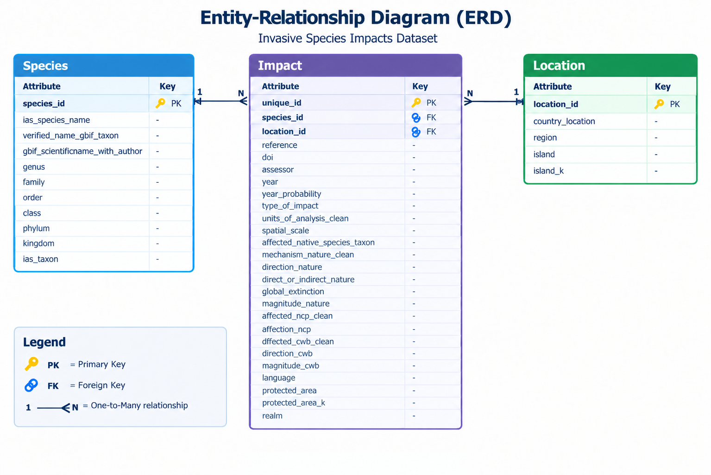

# Invasive Alien Species and Their Impact on the Environment and Human Activities
---

## Project Context

This project was completed as part of the Data Science and Machine Learning Bootcamp at Ironhack Germany GmbH.

I independently selected the research topic, dataset, and research questions. The course provided a project template outlining potential analytical methods and techniques, which I adapted to my research questions and to the dataset.

---

## Project Overview

This project explores the Global Impacts Dataset of Invasive Alien Species (GIDIAS), in which the impacts of invasive alien species is documented. The goal of the project is to understand the dataset, identify data-quality issues, develop research questions, and prepare the data for a analysis in SQL.

### Dataset

This project uses the Global Impacts Dataset of Invasive Alien Species (GIDIAS). It has first been published on the 21. of May 2025 in Springer Nature and authored by S. Bacher et al.  (https://doi.org/10.6084/m9.figshare.27908838).

The dataset contains information about invasive alien species and their documented impact on the environment and on human activities.

Each row represents a record of an invasive alien species at a specific location, including its impact on the environment and human activities, as well as the year in which the impact was recorded or published.

The raw dataset contains:

* **22,865 observations**
* **90 columns**
* Information about species taxonomy
* Geographic information
* Introduction and impact years
* Impact mechanisms
* Impact magnitude
* Affected species, ecosystem services and human well-being
* References and source information

A separate metadata file provides descriptions and information about the variables in the dataset.

 Instructions for downloading the dataset and the metadata are provided in the How to Run section.

### Research Questions

The analysis focuses on the following three questions:

1. When did invasive species introductions peak, and was there a period of rapid increase?

2. Which regions and countries are most affected by invasive species?

3. Which invasive species have the greatest impact?

---

## Project Structure

The repository is organized into folders corresponding to the different stages of the analysis.

```text
invasive-species-impact-analysis/
├── data/              # Data files and related documentation
├── functions/         # Reusable Python functions
├── images/            # Visualizations and supporting images
├── notebooks/         # Jupyter notebooks for the analysis
├── presentation/      # Project presentation
├── sql/               # SQL queries and database-related files
├── src/               # Supporting Python scripts
├── requirements.txt   # Python dependencies
└── README.md          # Project documentation
```

The project follows an exploratory data analysis (EDA) (notebook 01) approach before cleaning the data and moving into database design (notebook 02) and SQL (sql folder) analysis. The SQL queries are stored separately to make them easier to review and reuse. In the final part the results are visualised and the hypothesis are confirmed or rejected (notebook 03). 

---
## Key Findings and Results

### Data Exploration (notebook 01_eda.ipynb)

The first stage of the project focused on understanding the structure and quality of the data.

The following aspects were investigated:

- Number of rows and columns
- Data types
- Missing values
- Unique identifiers
- Categorical and numerical variables

One important finding was that some variables contained multiple values in a single cell. For example, `Country.Location` and `Island` could contain several countries or islands separated by semicolons.

These fields therefore required special treatment before being used in a relational database.

The dataset contained both `rowID` and `UniqueID`.

`UniqueID` was unique for each record and was used to identify an individual impact record.

The species name was **not unique**, because one invasive species could occur in many different records.

For this reason, a separate `species_id` was created for each unique species when creating the tables.

---

### Data Processing (notebook 02-processing.ipynb)

#### Data Cleaning

To clean the data, unnecessary columns were discarded, and the column names were standardized. Furthermore, the data types of a few columns were changed for the analysis.

The cleaned data was saved in the `data/clean` folder.

#### Building the Tables

The dataset was split into three tables:

- An **impact** table containing information about the impact of each species, such as the magnitude of the impact, the realm affected, and the language in which the impact was first described.
    - The primary key was `unique_id`, which identified the impact of each species in a distinct country and region.
    - `species_id` was a foreign key created for each species.
    - `location_id` was another foreign key created for each region and country combination.

- A **species** table containing information about the species, such as family, class, and kingdom.
    - The primary key was `species_id`.

- A **location** table containing information about the location where the species had an impact, such as region and country.
    - The primary key was `location_id`.



The new tables were saved in `project_inv_sp.db`.

#### Data Analysis (queries.sql)

The data analysis was performed using SQLite. One or two queries were written for each hypothesis.

---

### Data Visualization and Hypothesis Evaluation (notebook 03-hypothesis_and_visualization.ipynb)

After loading the query results from the SQL file, visualizations were created for each research question.

Different visualization techniques were used to make the results easier to interpret and to highlight relevant patterns and differences in the data. Bar charts and stacked bar charts were created using Matplotlib and Seaborn, while other visualization types were used where they were more appropriate for the data.

The visualizations were then used to evaluate the hypotheses by comparing the observed patterns with the expectations defined in the research questions.

In the final part, the hypotheses were evaluated based on the results shown in the visualizations.

## Limitations and Future Improvements

---
## How to Run

### Installation and Reproducibility

This project was developed using Python, Jupyter Notebook, and SQLite.

To reproduce the analysis, follow the steps below.

#### 1. Clone the repository

```bash
git clone https://github.com/zoedoucet/invasive-species-impact-analysis.git
cd invasive-species-impact-analysis
```
#### 2. Install dependencies

```bash
python -m pip install -r requirements.txt
```

#### 3. Download the dataset

Download the GIDIAS dataset and its accompanying metadata from:

[Global Impacts Dataset of Invasive Alien Species (GIDIAS)](https://doi.org/10.6084/m9.figshare.27908838)

Place the downloaded files in the appropriate directory under `data/raw`.

#### 5. Run the notebooks

Execute the notebooks in the following order:

1. **Exploratory Data Analysis:** Explore the dataset and identify data quality issues.
2. **Data Cleaning and Processing:** Clean the data, prepare relational tables, and create the SQLite database.
3. **Analysis and Visualization:** Execute the SQL queries and generate visualizations.

Run the cells in each notebook sequentially, as later steps may depend on files generated during earlier stages.

---
### Requirements
The project uses:

* **Python**
* **Pandas** for data manipulation
* **Matplotlib** and **Seaborn** for visualisation
* **Seaborn** for statistical visualisations 
* **Jupyter Notebook** for exploratory analysis
* **SQL** for querying the final relational database
* **Git/GitHub** for version control